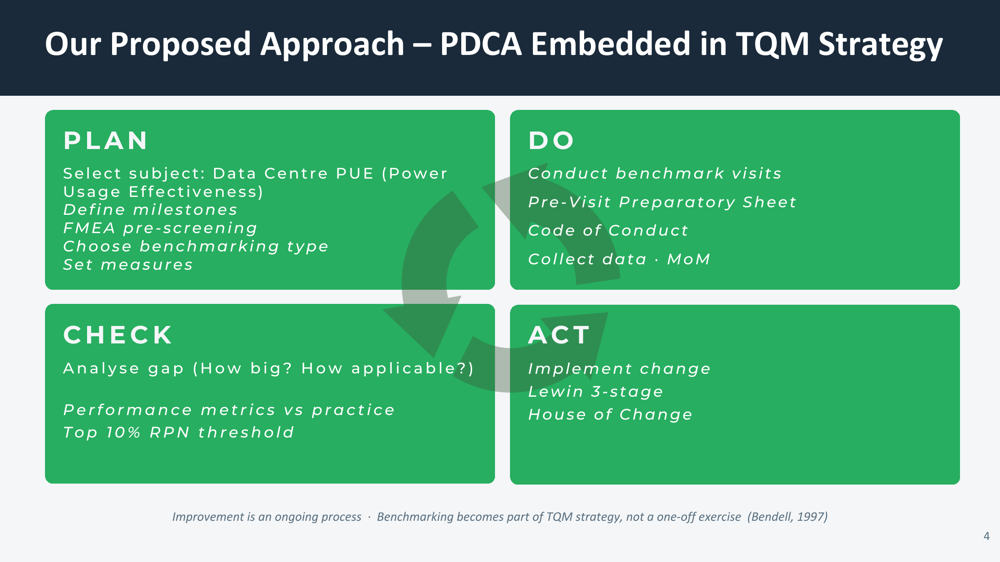
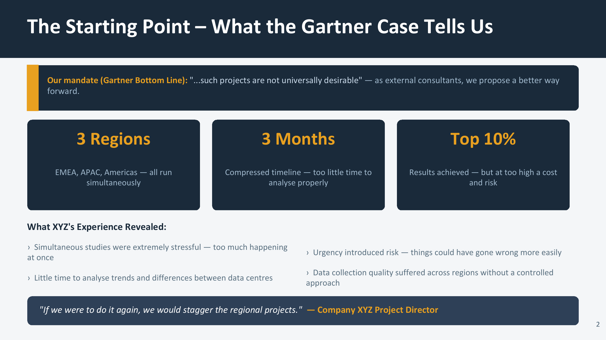
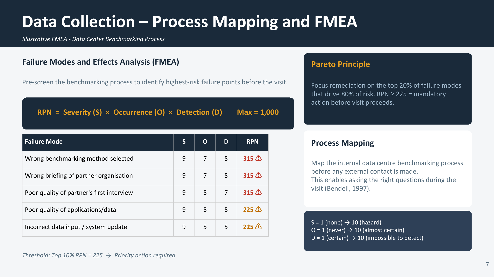

# Benchmarking Proposal — Company XYZ Data Centres - A Gartner Case Study

A consulting proposal to redesign a global benchmarking programme as part of a **Total Quality Management (TQM)** strategy — replacing three high-risk simultaneous regional studies with a staggered, PDCA-driven approach screened by **FMEA**.

> Academic consulting project — MBA International Business Consulting, Benchmarking (Hochschule Offenburg, Summer 2026). Company XYZ is a fictional/anonymised case; the methods and analysis are real coursework outputs.



*The core recommendation: benchmarking as a continuous PDCA cycle embedded in TQM, not a one-off exercise.*

---

## The problem

Building on a Gartner case study, Company XYZ ran three simultaneous benchmarking studies across EMEA, APAC, and the Americas inside a single three-month window. The results landed the firm in the top 10% of the Gartner database — but at unsustainable cost and risk. As the project director put it: *"If we were to do it again, we would definitely stagger the regional projects."* Acting as external consultants, our brief was to design a more efficient and effective benchmarking initiative that fixes those failures.

## What went wrong (and what we fixed)

| Issue in the original programme | Our fix |
|---|---|
| Resource overstretch running 3 regions in parallel | Staggered 3-year rollout: Y1 EMEA → Y2 APAC → Y3 Americas |
| No chance to learn between studies | Lessons from each region feed the next region's design |
| Inconsistent data quality across regions | Standardised PDCA process with a controlled method |
| Change resistance not managed | Lewin 3-stage change and a communication plan per region |

## The approach

- **PDCA embedded in TQM.** Each yearly study runs a full Deming Plan-Do-Check-Act cycle across six milestones, making benchmarking a continuous capability rather than a project (Bendell, 1997).
- **Functional benchmarking, not competitive.** Comparison with non-competitors performing the same data-centre functions (cooling, power, facilities), avoiding the legal/ethical risk of competitor data (Code of Conduct §6.2). Year-1 focus metric: **Power Usage Effectiveness (PUE)**.
- **FMEA pre-screening.** Before each study, a Failure Modes and Effects Analysis scores every failure mode by Risk Priority Number (RPN = Severity × Occurrence × Detection). Threshold set at the top 10% (**RPN ≥ 225**). Highest-risk modes — wrong method selected, wrong partner briefing, poor first interview (each **RPN 315**) — must be resolved before a visit proceeds. Pareto logic: 20% of failure modes drive 80% of the risk.




## Repository structure

```
01_proposal/            Full benchmarking proposal (14-slide PDF)
02_executive_summary/   One-page executive summary
assets/                 Key slides exported as images
```

## Methods demonstrated

Benchmarking (functional vs. competitive) · Total Quality Management (TQM) · Deming PDCA cycle · Failure Modes and Effects Analysis (FMEA) and Risk Priority Number scoring · Pareto analysis · SWOT · gap analysis · Lewin three-stage change model · stakeholder communication planning · benchmarking Code of Conduct.

## Team

Harsha · Mann · Aswin Biju — Tutor: Udo Fehlings

**Individual contribution (Aswin Biju):** *[confirm your specific role before publishing — e.g. FMEA/RPN risk-screening design, PDCA milestone structure, or the executive summary.]*

## License

Documentation and analysis released under CC BY 4.0 (see `LICENSE`).
